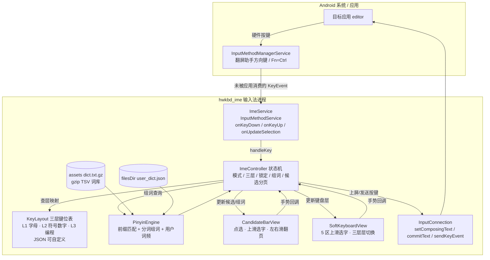

# System architecture

单模块 Android 工程 `app`，**物理键管线与拼音引擎不依赖 Android UI**，可跑 JVM 单测；UI 只有两个消费者：候选栏/软键盘（IME 窗口内）与设置/探测页（普通 Activity）。

## 分包职责

| 包 | 职责 | 关键类型 |
|---|---|---|
| `keymap` | 三层键位表、锁定/双击判定、键→动作 | `KeyLayout`、`KeyAction`、`TapTracker` |
| `engine` | 拼音解码、词库加载、用户词频 | `PinyinEngine`、`PinyinDict`、`UserDict` |
| `ime` | 纯逻辑状态机（无 Android UI 依赖） | `ImeController`、`ImeState`、`Selection` |
| `service` | Android 接线：KeyEvent、InputConnection、窗口 | `ImeService` |
| `ui` | 候选栏、软键盘、状态条（自绘 View） | `CandidateBarView`、`SoftKeyboardView` |
| `settings` | 偏好、层映射编辑、词库导入导出 | `SettingsActivity` |
| `probe` | 真机按键探测（抓 Sym/Fn 真实 keycode） | `KeyProbeActivity` |

## 关键设计约束

- `ImeController` 只通过回调（`commit`、`sendKey`、`render`）与 Android 层通信 → 单测覆盖三层切换、锁定、分页不需要设备。
- 按键**只在有组词或命中本输入法映射时才被消费**；空闲态原样放行，保证 Termux/vim 拿到原始按键。
- 词库一次性载入内存，输入路径上不做 IO。
