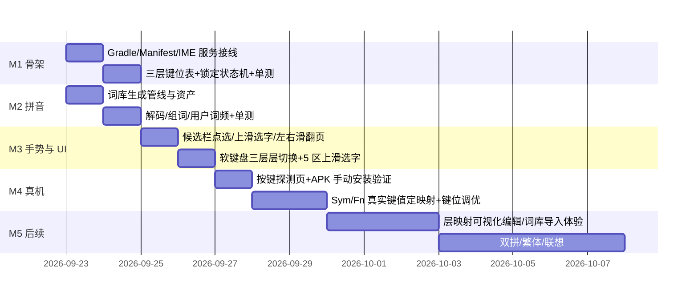

# Roadmap

## M1–M2（本周，可交付可安装 APK）

- 可构建工程（Gradle 8.7 + AGP 8.5.2 + Kotlin 1.9.24），装到 Titan 2 上能打字、能出候选框。
- 三层键位 + Alt/Sym 单击/双击锁定 + Shift/Caps 状态机全部有 JVM 单测。
- 拼音解码（前缀匹配 + DP 组词）+ 用户词频 + 内置词库资产。

## M3–M4（真机适配，关键风险段）

- 候选栏三通道手势全部可用：点选 / **上滑选字** / **左右滑翻页**；软键盘 5 区上滑选字。
- **按键探测页**：拿到 Titan 2 上 Sym / Fn / Back / Recent / 方向键的真实 keycode，据此把默认键位表定稿（当前是假设值）。
- 验证两条外部依赖：系统「翻屏助手」双击编辑模式是否真的把左右滑转成 `DPAD_LEFT/RIGHT`；Fn 设为 Ctrl 后是否能被输入法捕获。
- 每次改动出一个 APK，用户手动安装验证（无 adb），日志/键值通过探测页导出截图或文本回传。

## M5（体验完善）

- 层映射可视化编辑（当前为文本配置 + 导入导出）、词库导入向导与回退。
- 双拼、繁体、联想、快捷发送等可可的高级功能按需排期。
